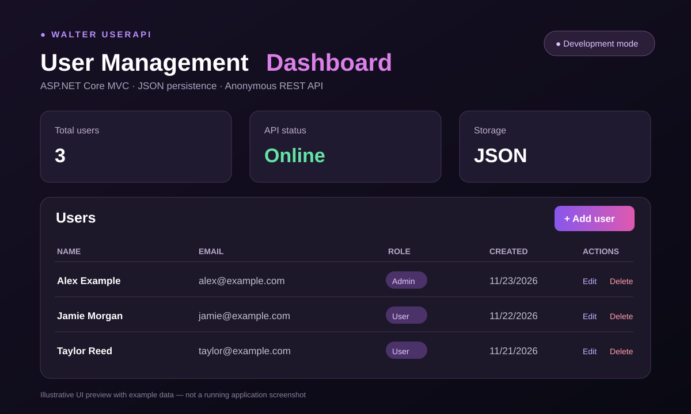
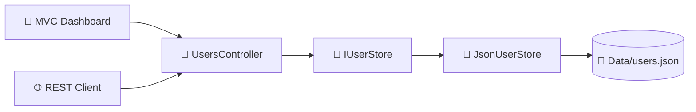

# 🌙 Walter UserAPI

**A dark-mode ASP.NET Core MVC dashboard and anonymous REST API for managing users.**

    

## ✨ Overview

Walter UserAPI provides a browser-based **user management dashboard** and five JSON REST endpoints. It uses a local JSON file rather than a database server. The interface has a dark background, purple-to-pink accents, user counters, editable records, and an add/edit dialog.

### 🖼️ UI previews

> **Important:** These are illustrative previews based on the dashboard design, with fictional example users. They are **not screenshots of a running .NET application**.

**Dashboard**



**Add user dialog**


## 🚀 Quick start

**Prerequisites:** [.NET 8 SDK](https://dotnet.microsoft.com/download/dotnet/8.0)

```bash
git clone https://github.com/1x4x/walter-userapi.git
cd walter-userapi
dotnet restore
dotnet run
```

Open **http://localhost:5080** for the UI, or **http://localhost:5080/api/users** for JSON. The launch profile specifies port 5080; use the URL printed by `dotnet run` if your environment overrides it.

## 🧩 Features

| | Feature | Details |
|---|---|---|
| 👥 | User CRUD | Create, list, view, edit, and delete users |
| 🌙 | Dark-mode UI | Responsive dashboard with purple/pink highlights |
| 🔓 | Anonymous endpoints | No account or token required |
| 💾 | JSON persistence | Saves to `Data/users.json` |
| 🧵 | Async storage | Serializes file access within one app process |
| ✅ | Validation | Required name/email, email format, length limits |
| 🛡️ | Duplicate protection | Rejects repeated email addresses (case-insensitive) |
| 📦 | Minimal dependencies | Uses ASP.NET Core built-in framework |

## 🔌 API reference

| HTTP | Route | Result |
|---|---|---|
| `GET` | `/api/users` | `200` list |
| `GET` | `/api/users/{id}` | `200` user / `404` |
| `POST` | `/api/users` | `201` created / `400` validation / `409` duplicate |
| `PUT` | `/api/users/{id}` | `204` updated / `400` / `404` / `409` |
| `DELETE` | `/api/users/{id}` | `204` deleted / `404` |

IDs are GUIDs. `POST` and `PUT` accept:

```json
{
  "name": "Alex Example",
  "email": "alex@example.com",
  "role": "User"
}
```

### 🧪 Try the API

**List users**

```bash
curl http://localhost:5080/api/users
```

**Create user**

```bash
curl -X POST http://localhost:5080/api/users \
  -H "Content-Type: application/json" \
  -d '{"name":"Alex Example","email":"alex@example.com","role":"User"}'
```

**Update user** (replace `YOUR_GUID` with the returned ID)

```bash
curl -X PUT http://localhost:5080/api/users/YOUR_GUID \
  -H "Content-Type: application/json" \
  -d '{"name":"Alex Updated","email":"alex@example.com","role":"Admin"}'
```

**Delete user**

```bash
curl -X DELETE http://localhost:5080/api/users/YOUR_GUID
```

## 🗂️ Project structure

```text
walter-userapi/
├── Controllers/
│   ├── HomeController.cs       # MVC dashboard
│   └── UsersController.cs      # Anonymous REST endpoints
├── Models/
│   └── User.cs                 # User and validated input
├── Services/
│   ├── IUserStore.cs           # Persistence contract
│   └── JsonUserStore.cs        # JSON file storage
├── Views/Home/
│   └── Index.cshtml            # Dashboard and CRUD interactions
├── wwwroot/css/
│   └── site.css                # Dark-mode styles
├── Data/users.json             # Persisted user records
├── docs/images/                # Illustrated UI previews
├── Properties/launchSettings.json
├── Program.cs
└── AnonymousUserMvcApi.csproj
```

## 🏗️ How it works



The MVC dashboard calls the same REST endpoints as external clients. `JsonUserStore` uses a semaphore to serialize reads and writes **within one process** and replaces the JSON file via a temporary file.

## ⚠️ Security and limitations

**All API endpoints allow anonymous CRUD access.** Anyone who can connect can read, create, modify, or delete records. **Run only on localhost or an explicitly trusted development network.** Do not store passwords, secrets, or sensitive user information.

For internet-facing use, add authentication, authorization, rate limiting, HTTPS enforcement, and suitable data protection. The JSON store is **not** designed for multiple server instances or concurrent processes.

## 🔧 Development status

The code has been added to the repository, but a .NET build, automated tests, and live browser screenshots **have not been verified** in this environment. The images above are design previews, not evidence of a successful runtime test.

---
Made with 💜 using C#, ASP.NET Core MVC, and JSON.
